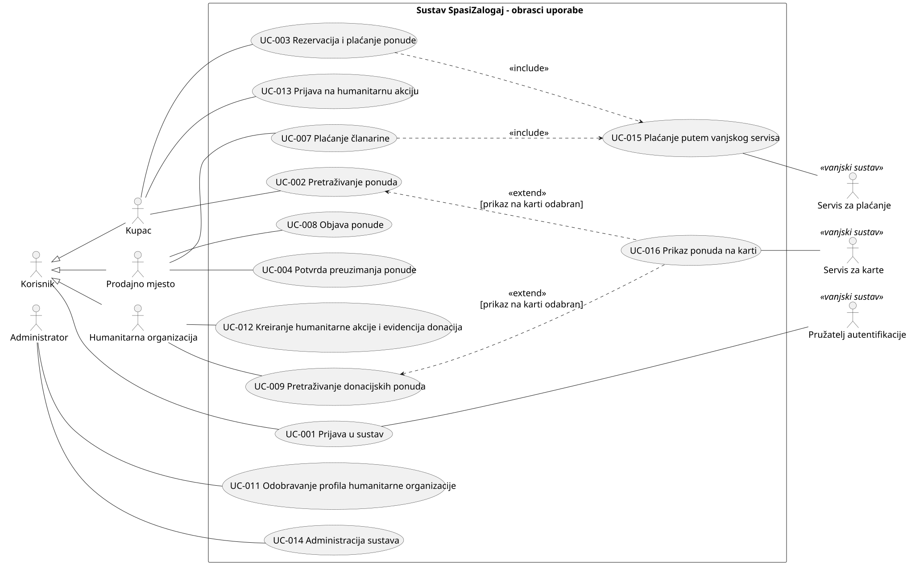
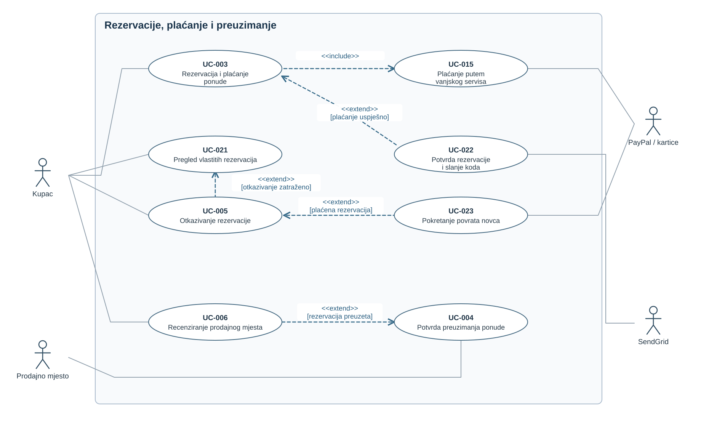
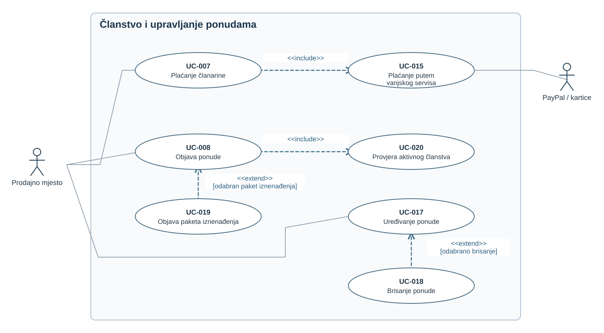

# 3. Obrasci uporabe

## 3.1 Dijagram obrazaca uporabe

**Slika 3.1. Dijagram obrazaca uporabe sustava Spasi Zalogaj**

**PlantUML izvor:** [izvor](./puml/3-1-system-UC-V2.puml)

Dijagram prikazuje osnovne obrasce uporabe sustava i njihove veze s akterima. Kupac, predstavnik prodajnog mjesta i predstavnik humanitarne organizacije specijalizacije su općenitog aktera „Korisnik”; administrator je prikazan zasebno. Vanjski sustavi uključuju pružatelja autentifikacije (OAuth 2.0), servis za plaćanje i servis za karte. Odnosi `<<include>>` prikazuju obvezne uključene obrasce (primjerice plaćanje), a `<<extend>>` uvjetne mogućnosti (primjerice prikaz na karti). Za preglednost je detaljniji dio procesa rezervacija i upravljanja ponudama izdvojen na dodatne dijagrame.

### Dodatni dijagram: rezervacije, plaćanje, preuzimanje i recenzije

**Slika 3.2. Dijagram obrazaca uporabe – rezervacije, plaćanje, preuzimanje i recenzije**

**PlantUML izvor:** [izvor](./puml/3-2-reservations-UC.puml)

Dodatni dijagram prikazuje rezervaciju i plaćanje ponude (UC-003), potvrdu preuzimanja kodom (UC-004), pregled vlastitih rezervacija (UC-021), otkazivanje (UC-005), recenziranje (UC-006) te povezane postupke plaćanja (UC-015), slanja koda (UC-022) i povrata novca (UC-023). Pri rezervaciji sustav provjerava raspoloživu količinu i privremeno je zadržava do dovršetka plaćanja. Nakon uspješnog plaćanja potvrđuje rezervaciju, generira jedinstveni kod i šalje potvrdu kupcu. Ako plaćanje nije dovršeno u dopuštenom roku, količina se ponovno oslobađa. Pri preuzimanju zaposlenik prodajnog mjesta provjerava kod, a kupac nakon preuzimanja može ostaviti recenziju. Otkazivanje je moguće iz pregleda vlastitih rezervacija, uz provjeru zadanog roka; za već plaćenu rezervaciju pokreće se povrat novca.

### Dodatni dijagram: članstvo i upravljanje ponudama

**Slika 3.3. Dijagram obrazaca uporabe – članstvo i upravljanje ponudama**

**PlantUML izvor:** [izvor](./puml/3-3-offers-membership-UC.puml)

Dijagram detaljnije prikazuje plaćanje članarine (UC-007), objavu ponude (UC-008), objavu paketa iznenađenja (UC-019), provjeru aktivnog članstva (UC-020) te uređivanje (UC-017) i brisanje ponude (UC-018). Objava ponude uključuje provjeru članstva; objava paketa iznenađenja uvjetno proširuje objavu ponude. Brisanje ponude prikazano je kao proširenje uređivanja ponude, uz uvjet da je brisanje odabrano i dopušteno. Kupac može pregledavati ponude (UC-002), uključujući prikaz na karti (UC-016).

## 3.2 Specifikacije obrazaca uporabe

Oznake aktera odgovaraju odjeljku 2.3: **A-01** Kupac, **A-02** Predstavnik prodajnog mjesta (uključuje zaposlenike koji potvrđuju preuzimanje), **A-03** Predstavnik humanitarne organizacije, **A-04** Administrator sustava, **A-05** Pružatelj autentifikacije (OAuth 2.0), **A-06** Servis za plaćanje (PayPal / kreditne kartice), **A-07** Servis za karte (Google Maps), **A-08** Servis za slanje e-pošte (SendGrid). Vanjski sustavi (A-05 do A-08) sudjeluju kao sekundarni akteri.

---

### UC-001: Registracija i prijava putem OAuth-a

| Element specifikacije | Opis |
|:--|:--|
| **Primarni akter** | Korisnik (A-01, A-02 ili A-03 ovisno o odabranoj ulozi); sekundarni akter: A-05 |
| **Povezani zahtjevi** | F-001, F-004, F-015 |
| **Preduvjeti** | Nema. |
| **Glavni uspješni tok** | 1. Korisnik odabire registraciju i jednog od ponuđenih OAuth pružatelja. 2. Pružatelj autentificira korisnika. 3. Aplikacija utvrđuje da profil ne postoji i traži odabir uloge: kupac, prodajno mjesto ili humanitarna organizacija. 4. Korisnik odabire ulogu i unosi podatke profila: za kupca osnovne podatke, za prodajno mjesto naziv tvrtke, OIB, lokaciju, kontakt, radno vrijeme i logo, za humanitarnu organizaciju naziv, kontakt i područje djelovanja. 5. Aplikacija provjerava podatke, kreira profil i prijavljuje korisnika. |
| **Alternativni tokovi / Iznimke** | **2a - Autentifikacija nije uspjela:** korisnik odustane ili pružatelj nije dostupan; aplikacija prikazuje poruku i korisnik ne ulazi u sustav. **3a - Profil već postoji (prijava):** aplikacija uspostavlja sesiju i prikazuje početnu stranicu prema ulozi, blokiranom korisniku prijava se odbija (UC-014). **4a - Nevaljani ili nepotpuni podaci:** aplikacija označava neispravna polja i ne kreira profil. |
| **Posljedice (ishod)** | Kupac ima aktivan profil. Profil humanitarne organizacije čeka odobrenje administratora (UC-011). Prodajno mjesto ima javni profil, a ponude može objavljivati tek uz aktivno članstvo (UC-007). Lozinke se ne pohranjuju (NF-03). |

---

### UC-002: Pregled i pretraživanje ponuda

| Element specifikacije | Opis |
|:--|:--|
| **Primarni akter** | A-01 Kupac |
| **Povezani zahtjevi** | F-002, F-027 |
| **Preduvjeti** | Kupac je prijavljen. |
| **Glavni uspješni tok** | 1. Kupac otvara početnu stranicu. 2. Aplikacija prikazuje aktivne ponude i pakete iznenađenja s nazivom, cijenom i rokom preuzimanja, ponude namijenjene isključivo donaciji ne prikazuju se. 3. Kupac filtrira i sortira ponude prema kategoriji, lokaciji, cijeni ili vremenu preuzimanja. 4. Kupac po želji odabire prikaz ponuda na karti (proširenje UC-016). 5. Kupac otvara detalje ponude. |
| **Alternativni tokovi / Iznimke** | **2a — Nema ponuda ili nijedna ne zadovoljava filtre:** aplikacija prikazuje odgovarajuću poruku. |
| **Posljedice (ishod)** | Prikazuju se samo ponude kojima nije istekao rok i koje nisu rasprodane. Podaci se ne mijenjaju. |

---

### UC-003: Rezervacija i plaćanje ponude

| Element specifikacije | Opis |
|:--|:--|
| **Primarni akter** | A-01 Kupac; sekundarni akter: A-06 |
| **Povezani zahtjevi** | F-008 |
| **Preduvjeti** | Kupac je prijavljen; ponuda je aktivna, nije namijenjena donaciji i ima dostupnu količinu. |
| **Glavni uspješni tok** | 1. Kupac odabire jedan ili više proizvoda odnosno paketa iz istoga prodajnog mjesta i potvrđuje rezervaciju. 2. Aplikacija provjerava raspoloživost, iznos i pripadnost stavki istom prodajnom mjestu te privremeno zadržava potrebnu količinu. 3. Kupac pokreće i dovršava online plaćanje (UC-015). 4. Nakon uspješnog plaćanja UC-022 uvjetno proširuje UC-015: potvrda rezervacije i slanje koda za preuzimanje (samo u kontekstu UC-003). |
| **Alternativni tokovi / Iznimke** | **2a – Ponuda je istekla, količina nije dostupna ili su stavke iz različitih prodajnih mjesta:** zahtjev se odbija uz poruku. **3a – Plaćanje nije dovršeno:** rezervacija ostaje u statusu „čeka uplatu”, bez koda za preuzimanje; korisnik može ponovno pokušati. Po isteku predviđenog roka rezervacija se poništava, a zadržana količina oslobađa. |
| **Posljedice (ishod)** | U slučaju uspjeha plaćanje je evidentirano, rezervacija je potvrđena i izvršen je UC-022; u suprotnom rezervacija nije aktivna za preuzimanje. |

---

### UC-004: Potvrda preuzimanja ponude

| Element specifikacije | Opis |
|:--|:--|
| **Primarni akter** | A-02 Predstavnik prodajnog mjesta (zaposlenik) |
| **Povezani zahtjevi** | F-009 |
| **Preduvjeti** | Zaposlenik je prijavljen; kupac je došao s potvrđenom rezervacijom i kodom (UC-022). |
| **Glavni uspješni tok** | 1. Kupac pokazuje kod za preuzimanje. 2. Zaposlenik kod upisuje ili skenira u aplikaciji. 3. Aplikacija provjerava da kod postoji, da pripada ponudi tog prodajnog mjesta i da rezervacija nije otkazana, već preuzeta niti istekla. 4. Aplikacija prikazuje podatke rezervacije; zaposlenik predaje proizvode i potvrđuje preuzimanje. |
| **Alternativni tokovi / Iznimke** | **3a - Kod nije valjan:** kod ne postoji, pripada drugom prodajnom mjestu, već je iskorišten ili je rok istekao; aplikacija odbija potvrdu i navodi razlog. |
| **Posljedice (ishod)** | Rezervacija je označena kao preuzeta, a kod više nije valjan. Kupac može ocijeniti prodajno mjesto (UC-006). |

---

### UC-005: Otkazivanje rezervacije

| Element specifikacije | Opis |
|:--|:--|
| **Primarni akter** | A-01 Kupac; sekundarni akter: A-06 ako je potreban povrat novca |
| **Povezani zahtjevi** | F-010 |
| **Preduvjeti** | Kupac je prijavljen, odabrao je vlastitu rezervaciju (UC-021) i ona nije preuzeta ni otkazana. |
| **Glavni uspješni tok** | 1. Kupac u pregledu vlastitih rezervacija odabire otkazivanje. 2. Aplikacija provjerava status rezervacije i da do isteka roka preuzimanja ima najmanje jedan sat. 3. Kupac potvrđuje otkazivanje. 4. Aplikacija označuje rezervaciju otkazanom, oslobađa rezerviranu količinu i obavještava prodajno mjesto. 5. Za već plaćenu rezervaciju pokreće povrat novca (UC-023). |
| **Alternativni tokovi / Iznimke** | **2a – Istekao rok ili status ne dopušta otkazivanje:** aplikacija odbija zahtjev uz objašnjenje. **3a – Kupac odustane:** rezervacija ostaje nepromijenjena. **5a – Povrat novca ne uspije:** rezervacija ostaje otkazana; povrat se bilježi za naknadnu obradu. |
| **Posljedice (ishod)** | Rezervacija je otkazana, količina ponovno raspoloživa, a za plaćenu rezervaciju evidentiran je zahtjev za povrat novca. |

---

### UC-006: Recenziranje prodajnog mjesta

| Element specifikacije | Opis |
|:--|:--|
| **Primarni akter** | A-01 Kupac |
| **Povezani zahtjevi** | F-011 |
| **Preduvjeti** | Kupac je prijavljen i preuzeo je rezervaciju u tom prodajnom mjestu. |
| **Glavni uspješni tok** | 1. Kupac otvara preuzetu rezervaciju i odabire ocjenu od 1 do 5. 2. Po želji upisuje komentar i šalje recenziju. 3. Aplikacija pohranjuje recenziju i prikazuje je na javnom profilu prodajnog mjesta. |
| **Alternativni tokovi / Iznimke** | **2a - Ocjena nije odabrana ili je rezervacija već ocijenjena:** aplikacija ne prihvaća recenziju i objašnjava razlog. |
| **Posljedice (ishod)** | Recenzija je vidljiva na profilu prodajnog mjesta. |

---

### UC-007: Plaćanje članarine

| Element specifikacije | Opis |
|:--|:--|
| **Primarni akter** | A-02 Predstavnik prodajnog mjesta; sekundarni akter: A-06 |
| **Povezani zahtjevi** | F-003, F-025 |
| **Preduvjeti** | Predstavnik je prijavljen. |
| **Glavni uspješni tok** | 1. Predstavnik otvara stranicu članarine; aplikacija prikazuje stanje članstva te cijene mjesečne i godišnje članarine. 2. Odabire razdoblje članarine. 3. Predstavnik plaća članarinu (uključuje UC-015). 4. Nakon uspješnog plaćanja aplikacija aktivira ili produljuje članstvo i prikazuje datum do kojeg vrijedi. |
| **Alternativni tokovi / Iznimke** | **3a - Plaćanje nije uspjelo (UC-015):** članstvo ostaje nepromijenjeno. |
| **Posljedice (ishod)** | Članstvo je aktivno do isteka plaćenog razdoblja; bez aktivnog članstva prodajno mjesto ne može objavljivati ponude (UC-008). |

---

### UC-008: Objava ponude

| Element specifikacije | Opis |
|:--|:--|
| **Primarni akter** | A-02 Predstavnik prodajnog mjesta |
| **Povezani zahtjevi** | F-005, F-012, F-025 |
| **Preduvjeti** | Predstavnik je prijavljen i ovlašten je za prodajno mjesto. |
| **Glavni uspješni tok** | 1. Predstavnik odabire objavu ponude proizvoda. 2. Sustav provjerava aktivno članstvo prodajnog mjesta (UC-020). 3. Predstavnik upisuje naziv, kategoriju, količinu, redovnu i sniženu cijenu, rok upotrebe, vrijeme preuzimanja i po želji dodaje fotografije. 4. Po želji označuje proizvod kao namijenjen isključivo humanitarnim organizacijama. 5. Aplikacija provjerava podatke i objavljuje ponudu. |
| **Alternativni tokovi / Iznimke** | **2a – Članstvo nije aktivno:** objava se odbija, a predstavnik se upućuje na UC-007. **5a – Nepotpuni ili nevaljani podaci:** aplikacija prikazuje pogreške i ne objavljuje ponudu. **1a – Odabran paket iznenađenja:** izvršava se proširenje UC-019. |
| **Posljedice (ishod)** | Ponuda je objavljena: kupcima je vidljiva redovna ponuda, a humanitarnim organizacijama donacijska ponuda. Istekle i rasprodane ponude ne prikazuju se kao aktivne. |

---

### UC-009: Pregled donacijskih ponuda i slanje zahtjeva

| Element specifikacije | Opis |
|:--|:--|
| **Primarni akter** | A-03 Predstavnik humanitarne organizacije |
| **Povezani zahtjevi** | F-013 |
| **Preduvjeti** | Predstavnik je prijavljen, a profil organizacije odobren je od administratora. |
| **Glavni uspješni tok** | 1. Predstavnik otvara popis aktivnih ponuda namijenjenih donaciji. 2. Odabire ponudu i pregledava detalje. 3. Upisuje željenu količinu i šalje zahtjev za preuzimanje. 4. Aplikacija provjerava da količina ne prelazi dostupnu i pohranjuje zahtjev u stanju „čeka odluku”. |
| **Alternativni tokovi / Iznimke** | **1a - Profil nije odobren:** donacijske ponude nisu dostupne dok administrator ne odobri profil. **4a - Količina nije dostupna ili je ponuda istekla:** aplikacija odbija zahtjev i prikazuje dostupnu količinu. |
| **Posljedice (ishod)** | Zahtjev čeka odluku prodajnog mjesta (UC-010). |

---

### UC-010: Obrada zahtjeva humanitarnih organizacija

| Element specifikacije | Opis |
|:--|:--|
| **Primarni akter** | A-02 Predstavnik prodajnog mjesta |
| **Povezani zahtjevi** | F-014 |
| **Preduvjeti** | Predstavnik je prijavljen; postoji zahtjev u stanju „čeka odluku”. |
| **Glavni uspješni tok** | 1. Predstavnik otvara popis zaprimljenih zahtjeva i odabire zahtjev. 2. Aplikacija prikazuje organizaciju, ponudu, traženu količinu i dostupnost. 3. Predstavnik odobrava ili odbija zahtjev. 4. Aplikacija mijenja stanje zahtjeva, a kod odobrenja umanjuje dostupnu količinu ponude; organizacija vidi odluku. |
| **Alternativni tokovi / Iznimke** | **3a - Količina više nije dostupna ili je ponuda istekla:** aplikacija ne dopušta odobravanje i obavještava predstavnika. |
| **Posljedice (ishod)** | Zahtjev je odobren ili odbijen. |

---

### UC-011: Odobravanje profila humanitarne organizacije

| Element specifikacije | Opis |
|:--|:--|
| **Primarni akter** | A-04 Administrator sustava |
| **Povezani zahtjevi** | F-015, F-016 |
| **Preduvjeti** | Administrator je prijavljen; postoji profil organizacije u stanju „čeka odobrenje”. |
| **Glavni uspješni tok** | 1. Administrator otvara popis profila koji čekaju odobrenje. 2. Odabire profil i pregledava podatke. 3. Odobrava aktivaciju profila. 4. Aplikacija aktivira profil, čini ga javno vidljivim i omogućuje organizaciji korištenje funkcionalnosti humanitarne organizacije. |
| **Alternativni tokovi / Iznimke** | **3a - Odbijanje profila:** administrator profil odbija uz razlog; profil ostaje neaktivan, a organizacija ga može ispraviti i ponovno poslati. |
| **Posljedice (ishod)** | Profil organizacije je aktivan i javno vidljiv ili odbijen uz razlog. |

---

### UC-012: Kreiranje humanitarne akcije i evidencija donacija

| Element specifikacije | Opis |
|:--|:--|
| **Primarni akter** | A-02 Predstavnik prodajnog mjesta ili A-03 Predstavnik humanitarne organizacije (organizator) |
| **Povezani zahtjevi** | F-017, F-020 |
| **Preduvjeti** | Organizator je prijavljen; ako je organizator humanitarna organizacija, profil mora biti odobren. |
| **Glavni uspješni tok** | 1. Organizator odabire kreiranje nove akcije. 2. Upisuje naziv, opis, lokaciju, datum početka i završetka te popis potrebnih vrsta proizvoda. 3. Aplikacija provjerava podatke i objavljuje akciju. 4. Nakon primitka donacija organizator evidentira stvarno zaprimljene proizvode i količine. |
| **Alternativni tokovi / Iznimke** | **3a - Nevaljani ili nepotpuni podaci:** npr. datum završetka prije datuma početka; aplikacija označava pogreške i ne objavljuje akciju. |
| **Posljedice (ishod)** | Akcija je objavljena i kupci se mogu prijaviti (UC-013); zaprimljene donacije evidentirane su uz akciju. |

---

### UC-013: Prijava u humanitarnu akciju

| Element specifikacije | Opis |
|:--|:--|
| **Primarni akter** | A-01 Kupac |
| **Povezani zahtjevi** | F-018, F-019 |
| **Preduvjeti** | Kupac je prijavljen; akcija je aktivna. |
| **Glavni uspješni tok** | 1. Kupac otvara popis akcija i odabire akciju. 2. Prijavljuje se za sudjelovanje. 3. Po želji označava proizvode iz popisa potrebnih vrsta koje planira donirati. 4. Aplikacija pohranjuje prijavu i planirane donacije. |
| **Alternativni tokovi / Iznimke** | **2a - Akcija je završila:** aplikacija ne dopušta prijavu. |
| **Posljedice (ishod)** | Kupac sudjeluje u akciji, a organizator vidi planirane donacije. |

---

### UC-014: Administracija sustava

| Element specifikacije | Opis |
|:--|:--|
| **Primarni akter** | A-04 Administrator sustava |
| **Povezani zahtjevi** | F-022, F-026 |
| **Preduvjeti** | Administrator je prijavljen. |
| **Glavni uspješni tok** | 1. Administrator odabire područje upravljanja: članarina, korisnici ili sadržaj. 2. Za članarinu mijenja iznos mjesečne ili godišnje članarine; za korisnike blokira ili briše profil; za sadržaj uklanja neprimjeren komentar, ponudu ili humanitarnu akciju. 3. Potvrđuje radnju. 4. Aplikacija provodi promjenu i prikazuje potvrdu. |
| **Alternativni tokovi / Iznimke** | **2a - Nevaljan iznos članarine:** iznos nije broj veći od nule; aplikacija ga odbija. **3a - Administrator odustane:** podaci ostaju nepromijenjeni. |
| **Posljedice (ishod)** | Nova cijena vrijedi za buduća plaćanja članarine (UC-007). Blokirani korisnik ne može se prijaviti (UC-001). Uklonjen sadržaj više nije vidljiv u aplikaciji. |

---

### UC-015: Plaćanje putem vanjskog servisa

| Element specifikacije | Opis |
|:--|:--|
| **Primarni akter** | A-01 Kupac ili A-02 Predstavnik prodajnog mjesta; sekundarni akter: A-06 |
| **Povezani zahtjevi** | F-003, F-008, NF-06 |
| **Preduvjeti** | Korisnik je prijavljen; aplikacija je odredila iznos za plaćanje rezervacije (UC-003) ili članarine (UC-007). |
| **Glavni uspješni tok** | 1. Aplikacija prikazuje iznos i nudi načine plaćanja: PayPal. 2. Korisnik odabire način plaćanja i preusmjerava se na vanjski servis. 3. Korisnik autorizira plaćanje kod vanjskog servisa. 4. Servis javlja uspjeh; aplikacija bilježi plaćanje i nastavlja obrazac uporabe iz kojeg je plaćanje pokrenuto. |
| **Alternativni tokovi / Iznimke** | **3a - Plaćanje nije uspjelo:** korisnik odustane, plaćanje je odbijeno ili servis nije dostupan; aplikacija prikazuje poruku i omogućuje novi pokušaj. Daljnji tijek određuje obrazac iz kojeg je plaćanje pokrenuto (UC-003, UC-007). |
| **Posljedice (ishod)** | Plaćanje je zabilježeno kao uspješno ili neuspješno. Podaci o kartici ne pohranjuju se u aplikaciji (NF-06). |

---

### UC-016: Prikaz ponuda na karti

| Element specifikacije | Opis |
|:--|:--|
| **Primarni akter** | A-01 Kupac; sekundarni akter: A-07 |
| **Povezani zahtjevi** | F-007 |
| **Preduvjeti** | Kupac je prijavljen i pregledava ponude (UC-002). |
| **Glavni uspješni tok** | 1. Kupac u pregledu ponuda odabire prikaz na karti. 2. Aplikacija traži pristup lokaciji kupca, a kupac ga dopušta. 3. Aplikacija na karti prikazuje oznake prodajnih mjesta čije su ponude prikazane u pregledu ponuda i udaljenost svakog od njih do kupca. 4. Kupac odabire oznaku; aplikacija prikazuje adresu prodajnog mjesta, udaljenost i njegove aktivne ponude. 5. Kupac otvara detalje ponude ili se vraća na popis ponuda (UC-002). |
| **Alternativni tokovi / Iznimke** | **2a - Kupac ne dopušta pristup lokaciji:** aplikacija prikazuje kartu s oznakama prodajnih mjesta, bez udaljenosti (AS-02). **3a - Servis za karte nije dostupan:** aplikacija prikazuje poruku i vraća kupca na popis ponuda s adresama prodajnih mjesta, bez karte (UC-002). |
| **Posljedice (ishod)** | Kupac vidi lokacije prodajnih mjesta s ponudama i, ako je dopustio pristup lokaciji, udaljenost do njih. Podaci se ne mijenjaju. |

---

### UC-017: Uređivanje ponude

| Element specifikacije | Opis |
|:--|:--|
| **Primarni akter** | A-02 Predstavnik prodajnog mjesta |
| **Povezani zahtjevi** | F-024 |
| **Preduvjeti** | Predstavnik je prijavljen; ponuda pripada njegovu prodajnom mjestu i za nju ne postoje rezervacije. |
| **Glavni uspješni tok** | 1. Predstavnik otvara popis vlastitih ponuda i odabire ponudu. 2. Odabire uređivanje i mijenja dopuštene informacije ponude. 3. Aplikacija provjerava ovlasti, postojanje rezervacija i valjanost novih podataka. 4. Sprema promjene i prikazuje ažuriranu ponudu. |
| **Alternativni tokovi / Iznimke** | **3a – Ponuda ne pripada prodajnom mjestu ili već ima rezervacije:** promjene se odbijaju. **3b – Podaci su nevaljani:** promjene se ne spremaju. **2a – Odabrano brisanje:** pokreće se UC-018. |
| **Posljedice (ishod)** | Podaci ponude ažurirani su bez izmjene postojećih rezervacija. |

---

### UC-018: Brisanje ponude

| Element specifikacije | Opis |
|:--|:--|
| **Primarni akter** | A-02 Predstavnik prodajnog mjesta |
| **Povezani zahtjevi** | F-024 |
| **Preduvjeti** | Predstavnik upravlja vlastitom ponudom (UC-017) i za ponudu ne postoje rezervacije. |
| **Glavni uspješni tok** | 1. Predstavnik odabire brisanje ponude. 2. Aplikacija traži potvrdu te provjerava vlasništvo i nepostojanje rezervacija. 3. Predstavnik potvrđuje brisanje. 4. Aplikacija uklanja ponudu iz dostupnih ponuda. |
| **Alternativni tokovi / Iznimke** | **2a – Postoje rezervacije ili ponuda nije vlastita:** brisanje se odbija. **3a – Predstavnik odustane:** ništa se ne mijenja. |
| **Posljedice (ishod)** | Ponuda više nije dostupna za pregled ni rezervaciju. |

---

### UC-019: Objava paketa iznenađenja

| Element specifikacije | Opis |
|:--|:--|
| **Primarni akter** | A-02 Predstavnik prodajnog mjesta |
| **Povezani zahtjevi** | F-006, F-025 |
| **Preduvjeti** | Predstavnik je prijavljen, a tijekom objave ponude (UC-008) odabrao je paket iznenađenja. |
| **Glavni uspješni tok** | 1. Sustav provjerava aktivno članstvo kao i za ostale ponude (UC-020). 2. Predstavnik unosi okvirni sadržaj, ukupnu vrijednost, prodajnu cijenu, broj dostupnih paketa i rok preuzimanja, bez navođenja točnih artikala. 3. Aplikacija provjerava podatke i objavljuje paket iznenađenja. |
| **Alternativni tokovi / Iznimke** | **1a – Članstvo nije aktivno:** objava se odbija. **3a – Nedostaju podaci ili su nevaljani:** aplikacija prikazuje razlog i ne objavljuje paket. |
| **Posljedice (ishod)** | Paket iznenađenja dostupan je za pregled i rezervaciju dok je aktivan i ima raspoloživu količinu. |

---

### UC-020: Provjera aktivnog članstva

| Element specifikacije | Opis |
|:--|:--|
| **Primarni akter** | A-02 Predstavnik prodajnog mjesta (posredno, pri pokušaju objave) |
| **Povezani zahtjevi** | F-025 |
| **Preduvjeti** | Prijavljeni predstavnik pokušava objaviti ponudu (UC-008 ili UC-019). |
| **Glavni uspješni tok** | 1. Aplikacija pronalazi članarinu prodajnog mjesta. 2. Provjerava da postoji uspješno plaćena članarina i da njezino razdoblje uključuje trenutak objave. 3. Ako je članstvo aktivno, dopušta nastavak objave. |
| **Alternativni tokovi / Iznimke** | **2a – Članarina nije plaćena ili je istekla:** aplikacija zaustavlja objavu i upućuje na UC-007. |
| **Posljedice (ishod)** | Objavljivanje je dopušteno samo uz aktivno članstvo; sama provjera ne mijenja podatke. |

---

### UC-021: Pregled vlastitih rezervacija

| Element specifikacije | Opis |
|:--|:--|
| **Primarni akter** | A-01 Kupac |
| **Povezani zahtjevi** | F-023 |
| **Preduvjeti** | Kupac je prijavljen. |
| **Glavni uspješni tok** | 1. Kupac otvara „Moje rezervacije”. 2. Aplikacija prikazuje isključivo njegove rezervacije, stavke, ukupnu cijenu, rok preuzimanja i status (čeka uplatu, aktivna, preuzeta, otkazana ili istekla). 3. Uz uspješno plaćene aktivne rezervacije prikazuje se kod za preuzimanje. 4. Kupac odabire rezervaciju i po želji pokreće otkazivanje (UC-005). |
| **Alternativni tokovi / Iznimke** | **2a – Nema rezervacija:** aplikacija prikazuje prazan popis. **4a – Otkazivanje nije dopušteno:** aplikacija nudi samo pregled podataka. |
| **Posljedice (ishod)** | Kupac vidi stanje svojih rezervacija, bez pristupa tuđima. |

---

### UC-022: Potvrda rezervacije i slanje koda

| Element specifikacije | Opis |
|:--|:--|
| **Primarni akter** | A-01 Kupac (posredno, nakon plaćanja); sekundarni akter: A-08 |
| **Povezani zahtjevi** | F-009 |
| **Preduvjeti** | Za rezervaciju iz UC-003 zaprimljena je potvrda uspješnog plaćanja iz UC-015. |
| **Glavni uspješni tok** | 1. Aplikacija potvrđuje rezervaciju i ažurira njezin status. 2. Generira jedinstveni kod za preuzimanje i povezuje ga s rezervacijom. 3. Prikazuje kupcu potvrdu i kod za preuzimanje. 4. Šalje potvrdu i kod e-poštom putem servisa SendGrid. |
| **Alternativni tokovi / Iznimke** | **4a – Slanje e-pošte nije uspjelo:** rezervacija ostaje potvrđena, a kod dostupan kupcu u pregledu rezervacije (UC-021); neuspjeh slanja bilježi se za ponovni pokušaj. |
| **Posljedice (ishod)** | Plaćena rezervacija ima kod koji prodajno mjesto može provjeriti u UC-004. |

---

### UC-023: Pokretanje povrata novca

| Element specifikacije | Opis |
|:--|:--|
| **Primarni akter** | A-01 Kupac (posredno, pri otkazivanju); sekundarni akter: A-06 |
| **Povezani zahtjevi** | F-010 |
| **Preduvjeti** | Rezervacija je valjano otkazana u UC-005 i već je uspješno plaćena. |
| **Glavni uspješni tok** | 1. Aplikacija preuzima podatke o provedenom plaćanju. 2. Šalje zahtjev za povrat odgovarajućem vanjskom servisu. 3. Evidentira rezultat povrata i obavještava kupca. |
| **Alternativni tokovi / Iznimke** | **2a – Servis odbije povrat ili nije dostupan:** povrat se označuje kao neuspješan odnosno na čekanju i predviđa se naknadna obrada; otkazivanje rezervacije ostaje na snazi. |
| **Posljedice (ishod)** | Pokrenut je i evidentiran povrat novca za plaćenu, otkazanu rezervaciju. |

---

## 3.3 Provjera dosljednosti obrazaca uporabe

| Provjera | Pitanje za tim | Nalaz |
|:--|:--|:--|
| **Zahtjev** | Je li svaki važan obrazac uporabe povezan s postojećim zahtjevom? | Da. Obrasci UC-001 do UC-023 navode povezane zahtjeve iz odjeljka 2.1. Upravljanje ponudama prikazano je kroz UC-017 i UC-018, paketi iznenađenja kroz UC-019, pregled rezervacija kroz UC-021, slanje koda kroz UC-022 te povrat novca kroz UC-023. Naknadno uređivanje javnog profila prodajnog mjesta (dio F-004) i odgovor prodajnog mjesta na recenziju (dio F-011) nisu zasebno razrađeni. |
| **Akter** | Odgovara li akter naveden ovdje prethodno utvrđenoj ulozi i dopuštenoj interakciji? | Da. Primarni akteri (A-01 do A-04) i sekundarni akteri (A-05 do A-08) odgovaraju ulogama iz odjeljka 2.3. Samo A-02 objavljuje i uređuje vlastite ponude te potvrđuje preuzimanje, samo A-03 podnosi zahtjeve za donaciju, a samo A-04 odobrava profile i administrira sustav. Vanjski sustavi sudjeluju u autentifikaciji, plaćanju/povratu, prikazu na karti i slanju e-pošte. |
| **Aplikacija** | Može li tim demonstrirati opisani glavni rezultat i važnu alternativu ili je opis jasno označen kao trenutačno oblikovanje? | Opisi tokova predstavljaju planirano ponašanje; samo postojanje specifikacije ne znači da su svi scenariji implementirani i ispitani. |

Povezivanje zahtjev -> obrazac uporabe -> ispitivanje vodi se **samo u [tablici sljedivosti zahtjeva](2-Analiza-zahtjeva.md#26-sljedivost-zahtjeva)**, ovdje se ne ponavlja.

**Zahtjevi bez zasebnog obrasca uporabe:** Odgovor prodajnog mjesta na recenziju (dio F-011), pretplata na obavijesti (F-021) i naknadno uređivanje profila prodajnog mjesta (dio F-004) nemaju zasebnu specifikaciju. Uređivanje i brisanje ponuda (F-024) sada su razrađeni kroz UC-017 i UC-018.

**Završna provjera:** Specifikacije obrazaca uporabe, akteri i zahtjevi međusobno su usklađeni na razini ovoga poglavlja. Posebne detalje poslovnih pravila potrebno je potvrditi s timom prije konačnog ispitivanja.
