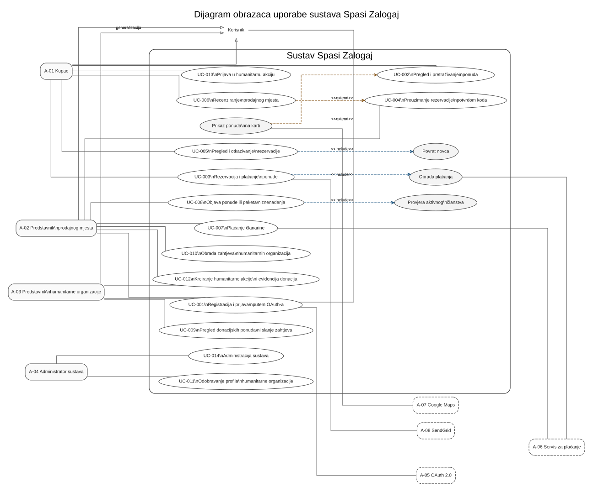
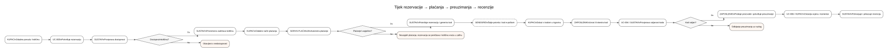

# 3. Obrasci uporabe

## 3.1 Dijagram obrazaca uporabe

**Slika 3.1. Dijagram obrazaca uporabe sustava Spasi Zalogaj**

**PlantUML izvor:** [izvor](./puml/3-1-system-UC.puml)

Dijagram prikazuje granicu sustava, četiri primarna aktera i četiri sekundarna aktera. Kupac, predstavnik prodajnog mjesta i predstavnik humanitarne organizacije specijalizacije su općenitog aktera „Korisnik”; administrator je prikazan zasebno. Sekundarni akteri su pružatelj autentifikacije (OAuth 2.0), servis za plaćanje, servis za karte (Google Maps) i servis za slanje e-pošte SendGrid (A-08). Odnosi `<<include>>` izdvajaju obveznu obradu plaćanja (UC-003), provjeru aktivnog članstva pri objavi ponude (UC-008) i povrat novca pri otkazivanju rezervacije (UC-005). Odnosi `<<extend>>` prikazuju neobvezni prikaz ponuda na karti kao proširenje pregleda ponuda (UC-002) te recenziranje kao proširenje preuzimanja rezervacije (UC-004). SendGrid sudjeluje u slanju potvrde rezervacije i koda za preuzimanje u UC-003.

### Dodatni dijagram: tijek rezervacije, plaćanja, preuzimanja i recenzije

**Slika 3.2. Tijek rezervacije, plaćanja, preuzimanja i recenzije**

**PlantUML izvor:** [izvor](./puml/3-2-reservation-flow.puml)

Dodatni dijagram detaljnije prikazuje povezani tijek koji započinje odabirom ponude i potvrdom rezervacije (UC-003). Sustav najprije provjerava dostupnost količine; ako količine nema, prikazuje obavijest i postupak završava. Ako je ponuda dostupna, količina se privremeno zadržava, a kupac odabire način plaćanja. Vanjski servis autorizira plaćanje. U slučaju neuspjeha sustav obavještava kupca, a nedovršena rezervacija poništava se nakon zadanog roka te se količina vraća u zalihu. Nakon uspješnog plaćanja sustav potvrđuje rezervaciju, generira jedinstveni kod i šalje potvrdu s kodom putem SendGrida (A-08). Pri dolasku u prodajno mjesto zaposlenik unosi ili skenira kod, a sustav provjerava njegovu valjanost (UC-004). Ako je kod valjan, zaposlenik predaje proizvode i potvrđuje preuzimanje. Nakon toga kupac može ostaviti ocjenu i komentar, što odgovara proširenju UC-004 obrascem UC-006. Nevaljan kod zaustavlja postupak preuzimanja uz prikaz razloga.

## 3.2 Specifikacije obrazaca uporabe

Oznake aktera odgovaraju odjeljku 2.3: **A-01** Kupac, **A-02** Predstavnik prodajnog mjesta (uključuje zaposlenike koji potvrđuju preuzimanje), **A-03** Predstavnik humanitarne organizacije, **A-04** Administrator sustava, **A-05** Pružatelj autentifikacije (OAuth 2.0), **A-06** Servis za plaćanje (PayPal / kreditne kartice), **A-07** Servis za karte (Google Maps), **A-08** Servis za slanje e-pošte (SendGrid). Vanjski sustavi (A-05 do A-08) sudjeluju kao sekundarni akteri.

---

### UC-001: Registracija i prijava putem OAuth-a

| Element specifikacije | Opis |
|:--|:--|
| **Primarni akter** | Korisnik (A-01, A-02 ili A-03 ovisno o odabranoj ulozi); sekundarni akter: A-05 |
| **Povezani zahtjevi** | F-001, F-004, F-015 |
| **Preduvjeti** | Nema. |
| **Glavni uspješni tok** | 1. Korisnik odabire registraciju i jednog od ponuđenih OAuth pružatelja. 2. Pružatelj autentificira korisnika. 3. Aplikacija utvrđuje da profil ne postoji i traži odabir uloge: kupac, prodajno mjesto ili humanitarna organizacija. 4. Korisnik odabire ulogu i unosi podatke profila: za kupca osnovne podatke, za prodajno mjesto naziv tvrtke, OIB, lokaciju, kontakt, radno vrijeme i logo, za humanitarnu organizaciju naziv, kontakt i područje djelovanja. 5. Aplikacija provjerava podatke, kreira profil i prijavljuje korisnika. |
| **Alternativni tokovi / Iznimke** | **2a - Autentifikacija nije uspjela:** korisnik odustane ili pružatelj nije dostupan; aplikacija prikazuje poruku i korisnik ne ulazi u sustav. **3a - Profil već postoji (prijava):** aplikacija uspostavlja sesiju i prikazuje početnu stranicu prema ulozi, blokiranom korisniku prijava se odbija (UC-014). **4a - Nevaljani ili nepotpuni podaci:** aplikacija označava neispravna polja i ne kreira profil. |
| **Posljedice (ishod)** | Kupac ima aktivan profil. Profil humanitarne organizacije čeka odobrenje administratora (UC-011). Prodajno mjesto ima javni profil, a ponude može objavljivati tek uz aktivno članstvo (UC-007). Lozinke se ne pohranjuju (NF-03). |

---

### UC-002: Pregled i pretraživanje ponuda

| Element specifikacije | Opis |
|:--|:--|
| **Primarni akter** | A-01 Kupac |
| **Povezani zahtjevi** | F-002, F-027 |
| **Preduvjeti** | Kupac je prijavljen. |
| **Glavni uspješni tok** | 1. Kupac otvara početnu stranicu. 2. Aplikacija prikazuje aktivne ponude i pakete iznenađenja s nazivom, cijenom i rokom preuzimanja, ponude namijenjene isključivo donaciji ne prikazuju se. 3. Kupac filtrira i sortira ponude prema kategoriji, lokaciji, cijeni ili vremenu preuzimanja. 4. Kupac po želji odabire prikaz ponuda na karti (proširenje UC-016). 5. Kupac otvara detalje ponude. |
| **Alternativni tokovi / Iznimke** | **2a — Nema ponuda ili nijedna ne zadovoljava filtre:** aplikacija prikazuje odgovarajuću poruku. |
| **Posljedice (ishod)** | Prikazuju se samo ponude kojima nije istekao rok i koje nisu rasprodane. Podaci se ne mijenjaju. |

---

### UC-003: Rezervacija i plaćanje ponude

| Element specifikacije | Opis |
|:--|:--|
| **Primarni akter** | A-01 Kupac; sekundarni akter: A-06 |
| **Povezani zahtjevi** | F-008 |
| **Preduvjeti** | Kupac je prijavljen; ponuda je aktivna, nije namijenjena donaciji i ima dostupnu količinu. |
| **Glavni uspješni tok** | 1. Kupac odabire količinu proizvoda ili paketa i potvrđuje rezervaciju. 2. Aplikacija provjerava dostupnost i privremeno zadržava količinu. 3. Kupac plaća rezervaciju (uključuje UC-015). 4. Nakon uspješnog plaćanja aplikacija potvrđuje rezervaciju i generira jedinstveni kod za preuzimanje. 5. Aplikacija prikazuje potvrdu i šalje je s kodom na e-poštu kupca. |
| **Alternativni tokovi / Iznimke** | **2a - Količina nije dostupna ili je ponuda istekla:** aplikacija ne prihvaća rezervaciju veću od raspoložive i prikazuje preostalu količinu. **3a - Plaćanje nije uspjelo:** kupac odustane, plaćanje je odbijeno ili servis nije dostupan; aplikacija prikazuje poruku, ne generira kod i omogućuje novi pokušaj. Ako plaćanje nije dovršeno u zadanom roku (npr. 15 minuta), rezervacija se poništava, a količina vraća u zalihu (NF-06). |
| **Posljedice (ishod)** | Rezervacija je potvrđena, količina ponude umanjena, a kupac ima potvrdu i kod za preuzimanje. |

---

### UC-004: Preuzimanje rezervacije potvrdom koda

| Element specifikacije | Opis |
|:--|:--|
| **Primarni akter** | A-02 Predstavnik prodajnog mjesta (zaposlenik) |
| **Povezani zahtjevi** | F-009 |
| **Preduvjeti** | Zaposlenik je prijavljen; kupac je došao s potvrđenom rezervacijom i kodom. |
| **Glavni uspješni tok** | 1. Kupac pokazuje kod za preuzimanje. 2. Zaposlenik kod upisuje ili skenira u aplikaciji. 3. Aplikacija provjerava da kod postoji, da pripada ponudi tog prodajnog mjesta i da rezervacija nije otkazana, već preuzeta niti istekla. 4. Aplikacija prikazuje podatke rezervacije; zaposlenik predaje proizvode i potvrđuje preuzimanje. |
| **Alternativni tokovi / Iznimke** | **3a - Kod nije valjan:** kod ne postoji, pripada drugom prodajnom mjestu, već je iskorišten ili je rok istekao; aplikacija odbija potvrdu i navodi razlog. |
| **Posljedice (ishod)** | Rezervacija je označena kao preuzeta, a kod više nije valjan. Kupac može ocijeniti prodajno mjesto (UC-006). |

---

### UC-005: Pregled i otkazivanje rezervacije

| Element specifikacije | Opis |
|:--|:--|
| **Primarni akter** | A-01 Kupac; sekundarni akter: A-06 |
| **Povezani zahtjevi** | F-010, F-023 |
| **Preduvjeti** | Kupac je prijavljen i ima potvrđenu rezervaciju koja nije preuzeta. |
| **Glavni uspješni tok** | 1. Kupac otvara popis svojih rezervacija sa stanjem i kodom. 2. Odabire rezervaciju i traži otkazivanje. 3. Aplikacija provjerava da do isteka roka preuzimanja ima najmanje jedan sat i traži potvrdu; kupac potvrđuje. 4. Aplikacija otkazuje rezervaciju, vraća proizvode u zalihu, obavještava prodajno mjesto i pokreće povrat novca. |
| **Alternativni tokovi / Iznimke** | **3a - Preostalo je manje od sat vremena:** aplikacija odbija otkazivanje i navodi razlog. **4a - Povrat novca nije uspio:** rezervacija ostaje otkazana, a aplikacija prikazuje poruku i povrat označava kao neuspio. |
| **Posljedice (ishod)** | Rezervacija je otkazana, količina je ponovno dostupna, a kupcu je vraćen novac. |

---

### UC-006: Recenziranje prodajnog mjesta

| Element specifikacije | Opis |
|:--|:--|
| **Primarni akter** | A-01 Kupac |
| **Povezani zahtjevi** | F-011 |
| **Preduvjeti** | Kupac je prijavljen i preuzeo je rezervaciju u tom prodajnom mjestu. |
| **Glavni uspješni tok** | 1. Kupac otvara preuzetu rezervaciju i odabire ocjenu od 1 do 5. 2. Po želji upisuje komentar i šalje recenziju. 3. Aplikacija pohranjuje recenziju i prikazuje je na javnom profilu prodajnog mjesta. |
| **Alternativni tokovi / Iznimke** | **2a - Ocjena nije odabrana ili je rezervacija već ocijenjena:** aplikacija ne prihvaća recenziju i objašnjava razlog. |
| **Posljedice (ishod)** | Recenzija je vidljiva na profilu prodajnog mjesta. |

---

### UC-007: Plaćanje članarine

| Element specifikacije | Opis |
|:--|:--|
| **Primarni akter** | A-02 Predstavnik prodajnog mjesta; sekundarni akter: A-06 |
| **Povezani zahtjevi** | F-003, F-025 |
| **Preduvjeti** | Predstavnik je prijavljen. |
| **Glavni uspješni tok** | 1. Predstavnik otvara stranicu članarine; aplikacija prikazuje stanje članstva te cijene mjesečne i godišnje članarine. 2. Odabire razdoblje članarine. 3. Predstavnik plaća članarinu (uključuje UC-015). 4. Nakon uspješnog plaćanja aplikacija aktivira ili produljuje članstvo i prikazuje datum do kojeg vrijedi. |
| **Alternativni tokovi / Iznimke** | **3a - Plaćanje nije uspjelo (UC-015):** članstvo ostaje nepromijenjeno. |
| **Posljedice (ishod)** | Članstvo je aktivno do isteka plaćenog razdoblja; bez aktivnog članstva prodajno mjesto ne može objavljivati ponude (UC-008). |

---

### UC-008: Objava ponude ili paketa iznenađenja

| Element specifikacije | Opis |
|:--|:--|
| **Primarni akter** | A-02 Predstavnik prodajnog mjesta |
| **Povezani zahtjevi** | F-005, F-006, F-012, F-025 |
| **Preduvjeti** | Predstavnik je prijavljen, a prodajno mjesto ima aktivno članstvo. |
| **Glavni uspješni tok** | 1. Predstavnik odabire objavu proizvoda ili paketa iznenađenja. 2. Za proizvod upisuje naziv, kategoriju, količinu, redovnu i sniženu cijenu, rok upotrebe i vrijeme do kojeg je moguće preuzimanje. Za paket upisuje okvirni sadržaj, ukupnu vrijednost, prodajnu cijenu, broj paketa i vrijeme preuzimanja, bez točnih artikala. 3. Po želji dodaje fotografije. 4. Za proizvod po želji označava da je namijenjen isključivo donaciji humanitarnim organizacijama. 5. Predstavnik objavljuje ponudu; aplikacija provjerava podatke i objavljuje je. |
| **Alternativni tokovi / Iznimke** | **1a - Članstvo nije aktivno:** aplikacija ne dopušta objavu i upućuje na plaćanje članarine (UC-007). **5a - Nepotpuni ili nevaljani podaci:** npr. snižena cijena nije niža od redovne ili je vrijeme preuzimanja u prošlosti; aplikacija označava pogreške i zadržava unesene podatke. |
| **Posljedice (ishod)** | Ponuda je vidljiva kupcima (UC-002), a ponuda namijenjena donaciji samo humanitarnim organizacijama (UC-009). Nakon isteka roka ili rasprodaje automatski se uklanja iz prikaza. |

---

### UC-009: Pregled donacijskih ponuda i slanje zahtjeva

| Element specifikacije | Opis |
|:--|:--|
| **Primarni akter** | A-03 Predstavnik humanitarne organizacije |
| **Povezani zahtjevi** | F-013 |
| **Preduvjeti** | Predstavnik je prijavljen, a profil organizacije odobren je od administratora. |
| **Glavni uspješni tok** | 1. Predstavnik otvara popis aktivnih ponuda namijenjenih donaciji. 2. Odabire ponudu i pregledava detalje. 3. Upisuje željenu količinu i šalje zahtjev za preuzimanje. 4. Aplikacija provjerava da količina ne prelazi dostupnu i pohranjuje zahtjev u stanju „čeka odluku”. |
| **Alternativni tokovi / Iznimke** | **1a - Profil nije odobren:** donacijske ponude nisu dostupne dok administrator ne odobri profil. **4a - Količina nije dostupna ili je ponuda istekla:** aplikacija odbija zahtjev i prikazuje dostupnu količinu. |
| **Posljedice (ishod)** | Zahtjev čeka odluku prodajnog mjesta (UC-010). |

---

### UC-010: Obrada zahtjeva humanitarnih organizacija

| Element specifikacije | Opis |
|:--|:--|
| **Primarni akter** | A-02 Predstavnik prodajnog mjesta |
| **Povezani zahtjevi** | F-014 |
| **Preduvjeti** | Predstavnik je prijavljen; postoji zahtjev u stanju „čeka odluku”. |
| **Glavni uspješni tok** | 1. Predstavnik otvara popis zaprimljenih zahtjeva i odabire zahtjev. 2. Aplikacija prikazuje organizaciju, ponudu, traženu količinu i dostupnost. 3. Predstavnik odobrava ili odbija zahtjev. 4. Aplikacija mijenja stanje zahtjeva, a kod odobrenja umanjuje dostupnu količinu ponude; organizacija vidi odluku. |
| **Alternativni tokovi / Iznimke** | **3a - Količina više nije dostupna ili je ponuda istekla:** aplikacija ne dopušta odobravanje i obavještava predstavnika. |
| **Posljedice (ishod)** | Zahtjev je odobren ili odbijen. |

---

### UC-011: Odobravanje profila humanitarne organizacije

| Element specifikacije | Opis |
|:--|:--|
| **Primarni akter** | A-04 Administrator sustava |
| **Povezani zahtjevi** | F-015, F-016 |
| **Preduvjeti** | Administrator je prijavljen; postoji profil organizacije u stanju „čeka odobrenje”. |
| **Glavni uspješni tok** | 1. Administrator otvara popis profila koji čekaju odobrenje. 2. Odabire profil i pregledava podatke. 3. Odobrava aktivaciju profila. 4. Aplikacija aktivira profil, čini ga javno vidljivim i omogućuje organizaciji korištenje funkcionalnosti humanitarne organizacije. |
| **Alternativni tokovi / Iznimke** | **3a - Odbijanje profila:** administrator profil odbija uz razlog; profil ostaje neaktivan, a organizacija ga može ispraviti i ponovno poslati. |
| **Posljedice (ishod)** | Profil organizacije je aktivan i javno vidljiv ili odbijen uz razlog. |

---

### UC-012: Kreiranje humanitarne akcije i evidencija donacija

| Element specifikacije | Opis |
|:--|:--|
| **Primarni akter** | A-02 Predstavnik prodajnog mjesta ili A-03 Predstavnik humanitarne organizacije (organizator) |
| **Povezani zahtjevi** | F-017, F-020 |
| **Preduvjeti** | Organizator je prijavljen; ako je organizator humanitarna organizacija, profil mora biti odobren. |
| **Glavni uspješni tok** | 1. Organizator odabire kreiranje nove akcije. 2. Upisuje naziv, opis, lokaciju, datum početka i završetka te popis potrebnih vrsta proizvoda. 3. Aplikacija provjerava podatke i objavljuje akciju. 4. Nakon primitka donacija organizator evidentira stvarno zaprimljene proizvode i količine. |
| **Alternativni tokovi / Iznimke** | **3a - Nevaljani ili nepotpuni podaci:** npr. datum završetka prije datuma početka; aplikacija označava pogreške i ne objavljuje akciju. |
| **Posljedice (ishod)** | Akcija je objavljena i kupci se mogu prijaviti (UC-013); zaprimljene donacije evidentirane su uz akciju. |

---

### UC-013: Prijava u humanitarnu akciju

| Element specifikacije | Opis |
|:--|:--|
| **Primarni akter** | A-01 Kupac |
| **Povezani zahtjevi** | F-018, F-019 |
| **Preduvjeti** | Kupac je prijavljen; akcija je aktivna. |
| **Glavni uspješni tok** | 1. Kupac otvara popis akcija i odabire akciju. 2. Prijavljuje se za sudjelovanje. 3. Po želji označava proizvode iz popisa potrebnih vrsta koje planira donirati. 4. Aplikacija pohranjuje prijavu i planirane donacije. |
| **Alternativni tokovi / Iznimke** | **2a - Akcija je završila:** aplikacija ne dopušta prijavu. |
| **Posljedice (ishod)** | Kupac sudjeluje u akciji, a organizator vidi planirane donacije. |

---

### UC-014: Administracija sustava

| Element specifikacije | Opis |
|:--|:--|
| **Primarni akter** | A-04 Administrator sustava |
| **Povezani zahtjevi** | F-022, F-026 |
| **Preduvjeti** | Administrator je prijavljen. |
| **Glavni uspješni tok** | 1. Administrator odabire područje upravljanja: članarina, korisnici ili sadržaj. 2. Za članarinu mijenja iznos mjesečne ili godišnje članarine; za korisnike blokira ili briše profil; za sadržaj uklanja neprimjeren komentar, ponudu ili humanitarnu akciju. 3. Potvrđuje radnju. 4. Aplikacija provodi promjenu i prikazuje potvrdu. |
| **Alternativni tokovi / Iznimke** | **2a - Nevaljan iznos članarine:** iznos nije broj veći od nule; aplikacija ga odbija. **3a - Administrator odustane:** podaci ostaju nepromijenjeni. |
| **Posljedice (ishod)** | Nova cijena vrijedi za buduća plaćanja članarine (UC-007). Blokirani korisnik ne može se prijaviti (UC-001). Uklonjen sadržaj više nije vidljiv u aplikaciji. |

---

### UC-015: Plaćanje putem vanjskog servisa

| Element specifikacije | Opis |
|:--|:--|
| **Primarni akter** | A-01 Kupac ili A-02 Predstavnik prodajnog mjesta; sekundarni akter: A-06 |
| **Povezani zahtjevi** | F-003, F-008, NF-06 |
| **Preduvjeti** | Korisnik je prijavljen; aplikacija je odredila iznos za plaćanje rezervacije (UC-003) ili članarine (UC-007). |
| **Glavni uspješni tok** | 1. Aplikacija prikazuje iznos i nudi načine plaćanja: PayPal. 2. Korisnik odabire način plaćanja i preusmjerava se na vanjski servis. 3. Korisnik autorizira plaćanje kod vanjskog servisa. 4. Servis javlja uspjeh; aplikacija bilježi plaćanje i nastavlja obrazac uporabe iz kojeg je plaćanje pokrenuto. |
| **Alternativni tokovi / Iznimke** | **3a - Plaćanje nije uspjelo:** korisnik odustane, plaćanje je odbijeno ili servis nije dostupan; aplikacija prikazuje poruku i omogućuje novi pokušaj. Daljnji tijek određuje obrazac iz kojeg je plaćanje pokrenuto (UC-003, UC-007). |
| **Posljedice (ishod)** | Plaćanje je zabilježeno kao uspješno ili neuspješno. Podaci o kartici ne pohranjuju se u aplikaciji (NF-06). |

---

### UC-016: Prikaz ponuda na karti

| Element specifikacije | Opis |
|:--|:--|
| **Primarni akter** | A-01 Kupac; sekundarni akter: A-07 |
| **Povezani zahtjevi** | F-007 |
| **Preduvjeti** | Kupac je prijavljen i pregledava ponude (UC-002). |
| **Glavni uspješni tok** | 1. Kupac u pregledu ponuda odabire prikaz na karti. 2. Aplikacija traži pristup lokaciji kupca, a kupac ga dopušta. 3. Aplikacija na karti prikazuje oznake prodajnih mjesta čije su ponude prikazane u pregledu ponuda i udaljenost svakog od njih do kupca. 4. Kupac odabire oznaku; aplikacija prikazuje adresu prodajnog mjesta, udaljenost i njegove aktivne ponude. 5. Kupac otvara detalje ponude ili se vraća na popis ponuda (UC-002). |
| **Alternativni tokovi / Iznimke** | **2a - Kupac ne dopušta pristup lokaciji:** aplikacija prikazuje kartu s oznakama prodajnih mjesta, bez udaljenosti (AS-02). **3a - Servis za karte nije dostupan:** aplikacija prikazuje poruku i vraća kupca na popis ponuda s adresama prodajnih mjesta, bez karte (UC-002). |
| **Posljedice (ishod)** | Kupac vidi lokacije prodajnih mjesta s ponudama i, ako je dopustio pristup lokaciji, udaljenost do njih. Podaci se ne mijenjaju. |

---

## 3.3 Provjera dosljednosti obrazaca uporabe

| Provjera | Pitanje za tim | Nalaz |
|:--|:--|:--|
| **Zahtjev** | Je li svaki važan obrazac uporabe povezan s postojećim zahtjevom? | Da. Svih 16 obrazaca uporabe (UC-001 do UC-016) u retku „Povezani zahtjevi” navodi samo zahtjeve definirane u odjeljku 2.1. Svi zahtjevi visokog i srednjeg prioriteta pokriveni su barem jednim obrascem uporabe, uz dva djelomična izuzetka: naknadno uređivanje javnog profila prodajnog mjesta iz F-004 nije zasebno opisano (izrada profila opisana je u UC-001), a UC-006 opisuje samo ostavljanje recenzije, ne i odgovor prodajnog mjesta iz F-011. |
| **Akter** | Odgovara li akter naveden ovdje prethodno utvrđenoj ulozi i dopuštenoj interakciji? | Da. Primarni akteri (A-01 do A-04) i sekundarni akteri (A-05 do A-07) odgovaraju ulogama iz odjeljka 2.3. Ovlasti su razdvojene: samo A-02 objavljuje ponude i obrađuje zahtjeve humanitarnih organizacija, samo A-03 šalje zahtjeve za donacije, a samo A-04 odobrava profile i upravlja sustavom (C-01). Vanjski sustavi sudjeluju samo kao sekundarni akteri: OAuth pružatelj pri prijavi (UC-001), servis za plaćanje pri plaćanju i povratu (UC-005, UC-015) te Google Maps pri prikazu karte (UC-016). |
| **Aplikacija** | Može li tim demonstrirati opisani glavni rezultat i važnu alternativu ili je opis jasno označen kao trenutačno oblikovanje? | Opisi tokova odgovaraju trenutačnom oblikovanju aplikacije. |

Povezivanje zahtjev -> obrazac uporabe -> ispitivanje vodi se **samo u [tablici sljedivosti zahtjeva](2-Analiza-zahtjeva.md#26-sljedivost-zahtjeva)**, ovdje se ne ponavlja.

**Zahtjevi bez zasebnog obrasca uporabe:** Odgovor prodajnog mjesta na recenziju (dio F-011), pretplata na obavijesti (F-021), uređivanje ili brisanje ponuda (F-024) te naknadno uređivanje profila prodajnog mjesta (dio F-004) nemaju zaseban obrazac uporabe jer tim zadržava opseg na ključne interakcije. U tablici sljedivosti označeni su kao „na čekanju”. Ako se implementiraju, odgovor na recenziju i F-024 dodaju se kao proširenja postojećih obrazaca (UC-006, odnosno UC-008), a F-021 i uređivanje profila prodajnog mjesta kao novi obrasci uporabe.

**Završna provjera:** Specifikacije obrazaca uporabe, akteri i zahtjevi međusobno su usklađeni. Svaki važan obrazac uporabe povezan je s postojećim zahtjevom, akteri odgovaraju ulogama iz analize zahtjeva, a zahtjevi bez zasebnog obrasca uporabe izričito su navedeni.
